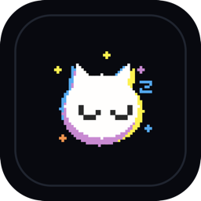
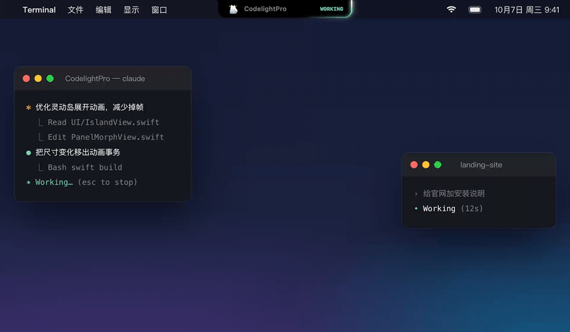
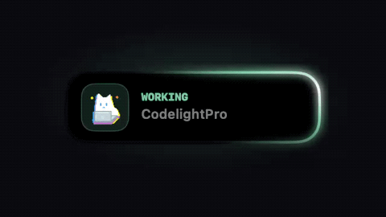
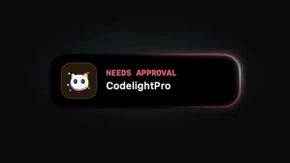
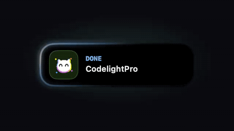
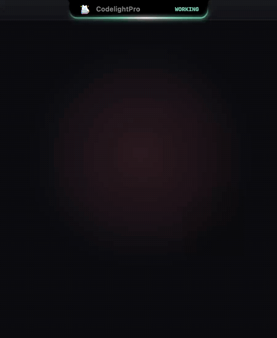
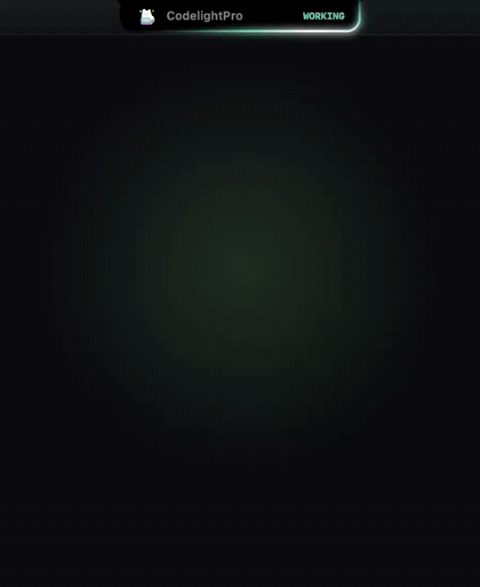
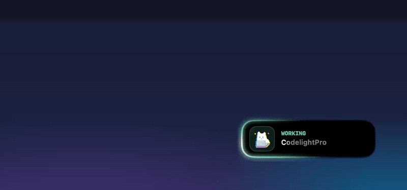

<div align="center">



# CodelightPro

**让 Agent 替你干活，你只管抬头看一眼。**

把 **Claude Code** 和 **Codex** 的状态放进 Mac 的刘海里：在工作、要审批、已完成，一眼便知；<br>
审批直接在灵动岛里点「允许」，剩余额度随手一看。

[](#安装)
[](Package.swift)
[](LICENSE)
[](https://github.com/501428005a-sys/CodelightPro/releases/latest)

**简体中文** · [English](README.en.md)



</div>

---

## 为什么做它

同时开着 Claude Code 和 Codex 跑任务时，最浪费时间的不是等，而是**反复切回终端看它是不是停了**：
可能早就跑完了，也可能卡在一个权限确认上等了你十分钟。

CodelightPro 把这件事交给屏幕顶部那一小块：

- 🟢 **工作中** —— 光圈在岛身上流动，你可以安心做别的事
- 🔴 **需审批** —— 光圈变红并弹系统通知，点开就能批
- 🔵 **已完成** —— 光圈变蓝，回去看结果

<table>
  <tr>
    <td align="center"><br><sub><b>工作中</b></sub></td>
    <td align="center"><br><sub><b>需审批</b></sub></td>
    <td align="center"><br><sub><b>已完成</b></sub></td>
  </tr>
</table>

## 功能

<table>
  <tr>
    <td width="50%" valign="top">
      
      <h3>在灵动岛里审批</h3>
      Agent 要执行命令时，审批卡会显示工具名、项目和<b>完整命令</b>，点「允许」或「拒绝」即可。
      也可以照常回终端处理，卡片会自动消失。Claude Code 与 Codex 都支持。
    </td>
    <td width="50%" valign="top">
      
      <h3>额度一眼看完</h3>
      5 小时额度、周额度、重置倒计时都在一个面板里。
      Codex 开箱即用；Claude Code 授权一次后显示与 <code>/status</code> 一致的官方百分比。
    </td>
  </tr>
</table>

### 灵动岛或悬浮窗，拖一下就切换



把悬浮窗拖到屏幕顶部中间，它会变形贴进刘海；按住灵动岛往下拖，又变回可以放在任何角落的悬浮窗。
没有刘海的 Mac 和外接显示器也能用。形态和所在屏幕都会被记住。

### 还有这些

- **项目名**：灵动岛上显示当前会话所在的 git 项目
- **菜单栏控制中心**：开机自启、空闲自动隐藏、音效、优先显示器
- **轻量原生**：SwiftUI 原生应用，常驻动画在 Core Animation 里运行，几乎不占 CPU
- **iPhone 同步（可选）**：配对 Codelight iPhone App 后，灵动岛和锁屏实时显示状态，手机上也能审批（见[下文](#iphone-同步可选)）

## 安装

### 下载

1. 到 [Releases](https://github.com/501428005a-sys/CodelightPro/releases/latest) 下载 `CodelightPro-<版本>.zip`，解压后把 `CodelightPro.app` 拖进「应用程序」。
2. 第一次打开：App 目前只有 ad-hoc 签名、**没有经过 Apple 公证**，会被系统拦下。打开「系统设置 → 隐私与安全性」，滚到底部点 **仍要打开**；或者在终端执行：

   ```bash
   xattr -dr com.apple.quarantine /Applications/CodelightPro.app
   ```

3. 屏幕右上角出现悬浮窗就说明在运行了。打开 Claude Code 或 Codex 跑个任务，它就会亮起来。

支持 macOS 13 及以上，Apple 芯片与 Intel 通用。

### 从源码构建

需要 Xcode 15+ 或对应的 Command Line Tools（Swift 5.9）。没有第三方依赖。

```bash
git clone https://github.com/501428005a-sys/CodelightPro.git
cd CodelightPro
bash scripts/make_app.sh      # release 编译并打包成 CodelightPro.app（含图标、ad-hoc 签名）
open CodelightPro.app
```

开发时也可以 `swift build` / `swift run`，或用 Xcode 直接打开 `Package.swift`。
`bash scripts/make_release.sh` 会打一个 arm64 + x86_64 通用包到 `dist/`。

## 显示 Claude Code 官方用量

Codex 的额度从本机直接读取，无需设置。Claude 的订阅额度只保存在 Anthropic 服务器上，需要授权一次：

- **在面板里点「连接 Claude」**（推荐），或
- 在终端运行 `bash scripts/setup_claude_token.sh`（内部执行 `claude setup-token`）

Token 只保存在本机 `~/.codelightpro/token`，权限 600。之后约每 60 秒刷新一次官方用量。

凭证按这个顺序查找：环境变量 `CLAUDE_CODE_OAUTH_TOKEN` → `~/.codelightpro/token` → Claude Code CLI 自己的登录凭证（钥匙串或 `~/.claude/.credentials.json`）→ Claude 桌面版的登录 cookie（读取前 macOS 会弹钥匙串授权，你可以拒绝）。

## 它会读写哪些东西

开源的意义之一，是你可以确认它没做多余的事。

| 位置 | 做什么 |
|---|---|
| `~/.codex/`、`~/.claude/` | **只读**会话状态与本地用量记录，不读、不传你的代码 |
| `~/.claude/settings.json` | 加几条只追加一行状态的 hooks，用来准确知道「工作中 / 需审批」；**修改前自动备份**为 `settings.json.codelightpro-backup` |
| `~/.codex/hooks.json` | 开启审批功能时加一条审批 hook，同样先备份 |
| `~/.codelightpro/` | 自己的状态、缓存和 token |
| 网络 | 只请求 Anthropic 的用量接口（`api.anthropic.com` / `claude.ai`）；配置了 iPhone 同步才会连接你填写的 relay 服务器。Codex 额度通过本机 `codex app-server` 获取，不读它的 token |

审批 hook **从不自己做决定**：App 没运行、审批开关关闭、你选了「在终端处理」，或者 5 分钟内没人回应，它都什么也不输出，Agent 会照常显示自己的确认提示。

## iPhone 同步（可选）

配套的 iPhone App **Codelight** 可以在灵动岛、锁屏上实时显示状态，并在手机上审批。它通过一个 relay 服务转发状态，扫一下 Mac 上的二维码即可绑定，不需要注册账号；只同步状态、项目名和待审批的命令。

iPhone App 与 relay 服务**不在本仓库开源**，iOS 测试版即将开放。不配置同步时，CodelightPro 完全在本地运行。

## 已知局限

- 每个工具只跟踪**最近活跃的那个会话**。
- 界面文案目前只有简体中文。
- `claude setup-token` 生成的是长期 token；若遇到 401（过期或撤销），重新授权一次即可。

## 项目结构

```
Sources/CodelightPro/
  AppDelegate.swift   窗口与面板：灵动岛 / 悬浮窗形态切换、菜单栏控制中心
  AppModel.swift      全局状态与偏好设置
  Poller.swift        每 2 秒轮询各 Monitor
  Monitors/           读取 ~/.codex、~/.claude；Claude 用量接口；hooks 安装
  Services/           relay 同步客户端、开机自启、音效
  UI/                 SwiftUI 视图；光圈、像素猫等常驻动画用 Core Animation
scripts/              打包、发布、图标渲染、Claude token 设置
```

## 参与贡献

欢迎提 Issue 和 PR。改完代码至少跑一次 `swift build`，界面改动请附截图或录屏。
用 AI 编码助手的话，仓库里的 [AGENTS.md](AGENTS.md) 写了架构要点和约定。

## 许可

[GPL-3.0](LICENSE)：可以自由使用、修改和再发布；发布修改版时也需要以 GPL-3.0 开源。

Claude Code 与 Codex 分别是 Anthropic 与 OpenAI 的产品，本项目与它们无隶属关系。
